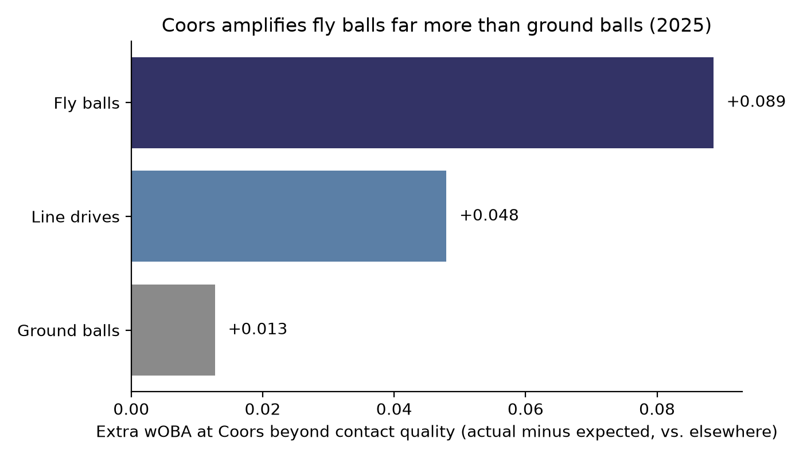
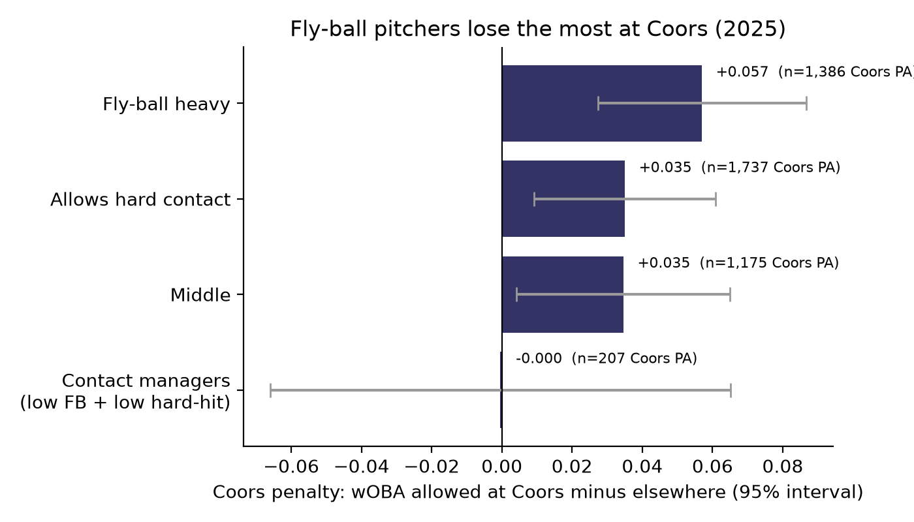
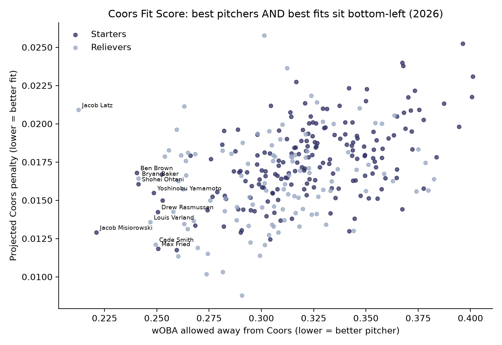

# Pitching at Altitude: Which Pitchers Hold Up at Coors Field?

**Elliot Malsam** · [elliotma27.github.io](https://elliotma27.github.io) · 2025 Statcast analysis in SQL (SQLite) and Python

## Question
Which pitcher profiles lose the least at Coors Field, why, and which pitchers fit that profile?

## Method
- Pulled the 2025 regular season of Statcast data (about 124,000 balls in play) with `pybaseball` and loaded it into SQLite.
- **Mechanism:** xwOBA is built only from exit velocity and launch angle, so it doesn't know about altitude. Comparing actual minus expected wOBA at Coors against other parks isolates where the park itself adds damage.
- **Archetypes:** grouped 311 pitchers (150+ balls in play) into thirds by fly-ball rate and hard-hit rate (SQL window functions), then compared wOBA allowed at Coors vs. elsewhere.
- **Coors Fit Score:** built a translation table of how much each exit velocity / launch angle bin gains at Coors (shrunk toward zero where Coors data is thin), then ran every pitcher's road batted balls through it to project his Coors penalty.

## Findings
**1. Coors amplifies fly balls far more than ground balls.** Relative to other parks, fly balls produced +0.089 wOBA beyond their contact quality, line drives +0.048, ground balls only +0.013.



**2. Fly-ball pitchers lose the most, and fly balls matter more than hard contact.** Fly-ball-heavy pitchers allowed +0.057 wOBA more at Coors (±0.030). Hard-contact pitchers without a fly-ball tendency lost about the same as average (+0.035). Contact managers showed no penalty, but on only 207 Coors PA, so that estimate is very uncertain.



**3. The best fits combine strikeouts and ground balls, but fit is a tiebreaker.** Projected penalties span only +0.014 to +0.025 wOBA, while talent (road wOBA) ranges from .22 to .38. Coors-proof starters include José Soriano, Tylor Megill, and Yoshinobu Yamamoto; relievers include Jhoan Durán, Abner Uribe, and Brad Keller. Full rankings: [`coors_fit_scores.csv`](coors_fit_scores.csv).



## Validation
At the group level, the score agrees with reality that fly-ball-heavy pitchers do worst. At the pitcher level, projected and actual Coors penalties are essentially uncorrelated (r = -0.03, n = 61), because one season gives most pitchers only 20 to 40 batters at Coors. This is a projection tool that needs more seasons to validate.

## What I'd explore next: scouting and development
If the Coors-fit profile is rare and expensive to acquire, it may be worth building instead of buying: scouting college and high school pitchers who already limit fly balls, and developing ground-ball traits (sinkers, steeper approach angles) within the system. The first question to answer is whether fly-ball tendencies carry over from college and the minors to the majors.

## Limitations
One season. Coors PA skew toward Rockies pitchers, and visiting pitchers at Coors face the Rockies' own lineup, which was weak in 2025 and likely hides some of the park effect. Weather, the humidor, and reduced breaking-ball movement aren't modeled. Archetype cutoffs are simple thirds.

## Next steps
Test whether 2025 scores predict 2026 Coors results, add seasons, adjust for opponent quality, and add pitch-level traits.

## Reproduce
```
pip install -r requirements.txt
python3 01_pull_data.py        # downloads 2025 Statcast (slow)
python3 02_build_db.py         # builds coors.db
# run queries.sql (Q1, Q2 v2, Q3 v2) in DB Browser for SQLite, then Write Changes
python3 03_charts_and_fits.py
python3 04_coors_fit_score.py
```
